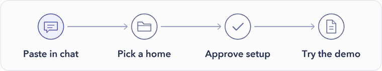
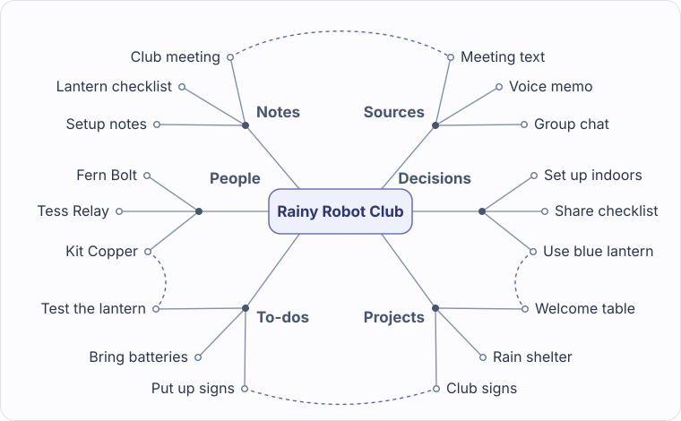

# memory-pa

Save a note today. Later, ask your AI assistant what you decided or who promised to do something. It can show you the note behind the answer.

## Start in chat

Open Codex, Claude Code, or Google Antigravity. **Copy this one message into chat.**

```text
Set up memory-pa with me. Start by asking where I want my notes to live.
Guide me one step at a time and do the setup I approve.
Follow the setup skill in https://github.com/anuj-pm-irl/memory-pa
```

1. **Pick a home for your notes.** Choose a folder on your computer, a private GitHub repo, or a private S3 bucket. A folder on this computer is the easiest place to start.
2. **Let the assistant do the setup you approve.** It can install what it needs, create or open the store, and check that it works. If it needs you to sign in, it hands control back. Enter any key in your own terminal’s hidden prompt, close the screen showing the key, and say **“Done.”**
3. **Try a made-up note together.** Ask “Who’s testing the blue lantern?” The demo finds Kit Copper and shows the note that says so.



## Save your first note

**Say** “Remember this for garden club. We picked basil for planting day. I’ll bring seeds.”

Check what the assistant plans to save and give it the okay. Next time, try **“What did we pick for planting day? Show me the note.”**

Already use a note taker? Say **“Help me connect Pocket and try one note.”** You can do the same with Granola or Plaud. [Note taker setup](docs/note-takers.md) · [Set up a routine](docs/note-takers.md#make-it-a-routine)

## How the memory map grows

The map is a set of linked files in the place you picked for your notes.

1. **The assistant prepares the note.** It picks out the people, decisions, and to-dos it can find in what you shared.
2. **memory-pa connects the pieces when you save.** It keeps the note and where it came from, links the people and projects mentioned, and updates the topic’s list of decisions and open tasks.
3. **Your next question follows those links.** Search finds matching notes and the assistant opens the section that supports its answer. Later notes can update a task while keeping the earlier note available.



Here’s how the Rainy Robot Club’s map could look after a few meetings. Follow the dashed lines from the club meeting to its source or from Kit Copper to the lantern test.

[See the full-size map](docs/media/memory-map.svg) · [Open the demo topic](examples/workspace/topics/robot-club/_summary.md) · [How the backend builds the map](docs/format.md#how-the-memory-map-is-built)

<details>
<summary>Set up in Terminal</summary>

Install [uv](https://docs.astral.sh/uv/getting-started/installation/) and [Git](https://git-scm.com/install), then run these in Terminal or PowerShell.

```sh
uv tool install --python 3.11 "git+https://github.com/anuj-pm-irl/memory-pa.git@v0.1.3"
memory-pa demo
memory-pa --store "~/Memory PA" init --remember
```

Replace `~/Memory PA` with the folder you want. If your terminal can’t find `memory-pa`, run `uv tool update-shell`, reopen the terminal, and try again. [Command guide](docs/commands.md) · [Private GitHub and S3 setup](docs/storage.md)

</details>

<details>
<summary>Use the skill in another project</summary>

Ask your assistant to install the [memory-pa skill](skills/memory-pa/SKILL.md) in that project. To do it yourself, save the file as `.agents/skills/memory-pa/SKILL.md` for Codex or Antigravity, or `.claude/skills/memory-pa/SKILL.md` for Claude Code. Start a new chat and say “Use the memory-pa skill.”

Share a memory across assistants by pointing them at the same folder or private storage address. [Storage guide](docs/storage.md)

</details>

[Contributing](CONTRIBUTING.md) · [MIT license](LICENSE)
