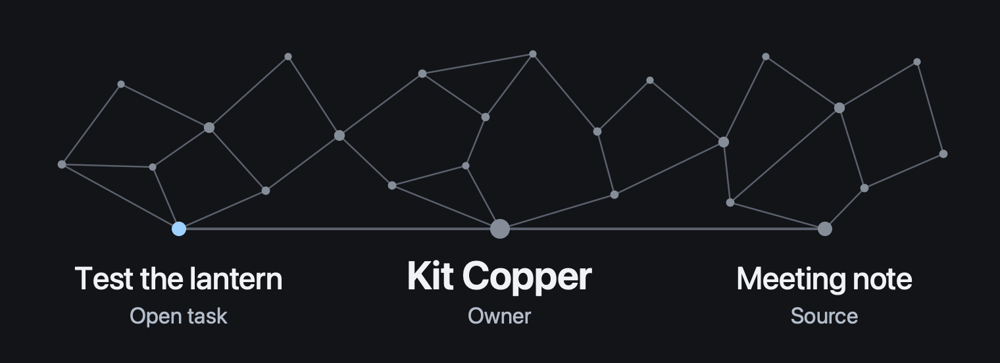

# memory-pa

A personal memory workspace any agent can write to, stored where you choose.

> **Who’s testing the blue lantern?**
>
> **Kit Copper.** [Read the original demo note](examples/workspace/topics/robot-club/rainy-robot-club-meeting-2026-02-03.md#source-text)

## Start in chat

Open Codex, Claude Code, or Google Antigravity. **Copy this one message into chat.**

```text
Set up memory-pa with me. Start by asking where I want my notes to live.
Guide me one step at a time and do the setup I approve.
Follow the setup skill in https://github.com/anuj-pm-irl/memory-pa
```

1. **Pick a home for your notes.** Choose a folder on your computer, a private GitHub repo, or a private S3 bucket. A folder on this computer is the easiest place to start.
2. **Let the assistant do the setup you approve.** It can install what it needs, create or open the store, and check that it works. If it needs you to sign in, it hands control back. Enter any key in your own terminal’s hidden prompt, close the screen showing the key, and say **“Done.”**
3. **Try a made-up note together.** Ask your assistant to run the demo with you, then ask who’s testing the blue lantern.

## Save your first note

**Say** “Remember this for garden club. We picked basil for planting day. I’ll bring seeds.”

Check what the assistant plans to save and give it the okay. Next time, try **“What did we pick for planting day? Show me the note.”**

Already use a note taker? Say **“Help me connect Pocket and try one note.”** You can do the same with Granola or Plaud. [Note taker setup](docs/note-takers.md) · [Set up a routine](docs/note-takers.md#make-it-a-routine)

## How the memory map grows

When you save a note, memory-pa keeps the original text and links the people, projects, decisions, and to-dos to it. It updates the topic summary so your assistant can see what changed and find the note behind an answer.

<picture>
  <source media="(prefers-reduced-motion: reduce)" srcset="docs/media/answer-trail.svg">
  
</picture>

The highlighted links come from the demo note. The wider map shows how the fictional club’s notes could connect after a few meetings.

[See the still diagram](docs/media/answer-trail.svg) · [Open the demo topic](examples/workspace/topics/robot-club/_summary.md) · [How the backend builds the map](docs/format.md#how-the-memory-map-is-built)

<details>
<summary>Set up in Terminal</summary>

Install [uv](https://docs.astral.sh/uv/getting-started/installation/) and [Git](https://git-scm.com/install), then run these in Terminal or PowerShell.

```sh
uv tool install --python 3.11 "git+https://github.com/anuj-pm-irl/memory-pa.git@v0.1.3"
memory-pa demo
memory-pa --store "~/Memory PA" init --remember
```

Replace `~/Memory PA` with the folder you want. If your terminal can’t find `memory-pa`, run `uv tool update-shell`, reopen the terminal, and try again. [Command guide](docs/commands.md) · [Private GitHub and S3 setup](docs/storage.md)

</details>

<details>
<summary>Use the skill in another project</summary>

Ask your assistant to install the [memory-pa skill](skills/memory-pa/SKILL.md) in that project. To do it yourself, save the file as `.agents/skills/memory-pa/SKILL.md` for Codex or Antigravity, or `.claude/skills/memory-pa/SKILL.md` for Claude Code. Start a new chat and say “Use the memory-pa skill.”

Share a memory across assistants by pointing them at the same folder or private storage address. [Storage guide](docs/storage.md)

</details>

[Contributing](CONTRIBUTING.md) · [MIT license](LICENSE)
