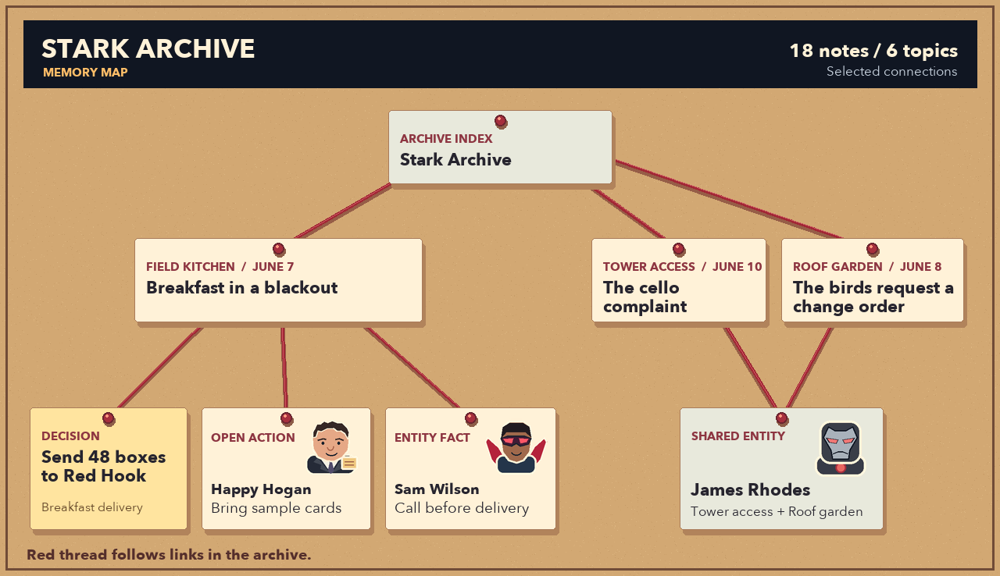

# memory-pa

**Power your agents with long-term memory.** Let an agent pick up a task in a new chat with the context it needs to act.

Start with the assistant you already use and a folder on your computer. Search runs locally over plain Markdown and JSON, and memory-pa updates the topic index and summaries with each save. You can also use private GitHub or S3 for a workspace your agents can share.

## From memory to action

On June 19, Tony Stark says, “JARVIS, remind whoever’s bringing the sample menu cards.” JARVIS opens the June 7 field kitchen note, finds the assignment and due date, then messages Happy Hogan about the June 20 dry run.

<picture>
  <source media="(prefers-reduced-motion: reduce)" srcset="docs/media/stark-archive-comic.png">
  
</picture>

memory-pa gives the agent the evidence. The agent uses its connected messaging tool for an authorized send. The fictional demo replays the lookup and previews the reminder. [Read the source note](examples/workspace/topics/field-kitchen/breakfast-in-a-blackout-2032-06-07.md#source-text) · [Browse the 18-note Stark Archive](examples/workspace/index.md)

## Start in chat

Open Codex, Claude Code, or Google Antigravity. **Copy this one message into chat.**

```text
Set up memory-pa with me. Start by asking where I want my notes to live.
Guide me one step at a time and do the setup I approve.
Follow the setup skill in https://github.com/anuj-pm-irl/memory-pa
```

1. **Choose where to keep your notes.** Pick a folder on your computer, private GitHub, or private S3. A folder on your computer is the easiest place to start.
2. **Let your assistant set it up.** Say yes to the steps you want it to do.
3. **Try the Avengers example.** Say **“Run the demo with me.”** It finds Happy’s assignment in the archive and previews the message JARVIS would send.

If you need to sign in, your assistant will pause so you can do it yourself. If you need an API key, it will guide you to a hidden prompt in your own terminal. Close the screen showing the key and say **“Done.”**

## Save your first note

Say **“Remember this”** and tell your assistant what to save. It will show you what it plans to keep. Say **“Yes, save it”** if it looks right. When you ask about it later, you can say **“Show me the note you used.”**

Already use a note taker? Say **“Help me connect Pocket and try one note.”** You can do the same with Granola or Plaud. [Note taker setup](docs/note-takers.md) · [Set up a routine](docs/note-takers.md#make-it-a-routine)

## How the memory map grows

memory-pa keeps the original text and links each dated note to its decisions, tasks, and the people or projects it mentions.



- **Facts and decisions.** The June 7 note records the decision to send 48 breakfast boxes to Red Hook and Sam Wilson’s plan to call ahead. The original wording stays available. [Field kitchen note](examples/workspace/topics/field-kitchen/breakfast-in-a-blackout-2032-06-07.md)
- **Beliefs and uncertainty.** Keep interpretations attributed in the note or summary. JARVIS’s guess that Peter is tired of shared clipboards stays a guess in the source. [Workshop note](examples/workspace/topics/workshop/the-robot-earns-saturday-2032-06-29.md#source-text)
- **Relationships and task history.** James Rhodes’s record connects notes from Tower Access and Roof Garden. When Happy shows the cards on June 20, that note closes the same task from June 7. [Follow the entity links](docs/format.md#how-the-memory-map-is-built) · [See the completed task](examples/workspace/topics/field-kitchen/the-card-in-the-red-sleeve-2032-06-20.md#action-items)

## Recall benchmarks

- **88.4% answer accuracy (442/500)** in a model-graded LongMemEval-S run with Codex and memory-pa. The agent opened and cited at least one expected source on **99.1% of answerable questions (466/470)**. [Method and results](docs/benchmarks.md)
- **80.6% top-five hit rate (29/36)** for local search on answerable Stark Archive queries. A hit means a supporting note appeared among the first five results. [Stark Archive benchmark](benchmarks/stark-archive/README.md#benchmark-results)

## Update in chat

When you’re ready to check for a new version, paste this into your assistant’s chat.

```text
Check for a memory-pa update and tell me what’s new. Ask before installing it.
After the update, check that you can still open my existing notes.
Follow https://github.com/anuj-pm-irl/memory-pa/blob/main/docs/commands.md#update-memory-pa
```

Update the CLI, then run `memory-pa upgrade` to check your existing store and `memory-pa upgrade --apply` to add its workspace instructions. The upgrade preserves your existing notes and workspace ID. [Update in Terminal](docs/commands.md#update-memory-pa)

<details>
<summary>Set up in Terminal</summary>

Install [uv](https://docs.astral.sh/uv/getting-started/installation/) and [Git](https://git-scm.com/install), then run these in Terminal or PowerShell.

```sh
uv tool install --python 3.11 "git+https://github.com/anuj-pm-irl/memory-pa.git@v0.1.4"
memory-pa demo
memory-pa --store "~/Memory PA" init --remember
```

Replace `~/Memory PA` with the folder you want. If your terminal can’t find `memory-pa`, run `uv tool update-shell`, reopen the terminal, and try again. [Command guide](docs/commands.md) · [Private GitHub and S3 setup](docs/storage.md)

</details>

## Open your memory in another agent

Open the managed memory folder or a checkout of its private Git branch as the agent's workspace. The root `AGENTS.md` explains how to find evidence and save notes. Claude Code loads it through `CLAUDE.md`. If your agent needs an explicit entry point, point it to `AGENTS.md`. Agents use the memory-pa CLI for consistent writes and can read a Git checkout or private export directly. [Storage guide](docs/storage.md)

[Contributing](CONTRIBUTING.md) · [MIT license](LICENSE)
