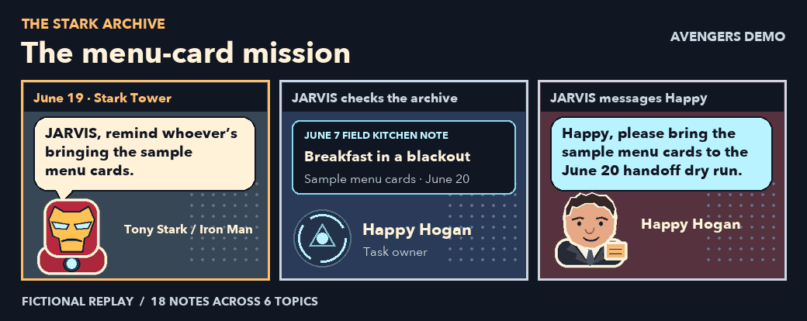
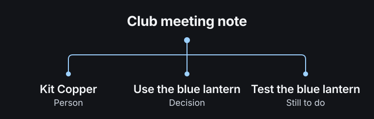

# memory-pa

Save a note with your AI assistant. Later, ask a question about it and see the note behind the answer. You choose where your notes live.

<picture>
  <source media="(prefers-reduced-motion: reduce)" srcset="docs/media/save-ask-answer.svg">
  
</picture>

[Read the sample meeting note](examples/workspace/topics/robot-club/rainy-robot-club-meeting-2026-02-03.md#source-text)

## Start in chat

Open Codex, Claude Code, or Google Antigravity. **Copy this one message into chat.**

```text
Set up memory-pa with me. Start by asking where I want my notes to live.
Guide me one step at a time and do the setup I approve.
Follow the setup skill in https://github.com/anuj-pm-irl/memory-pa
```

1. **Choose where to keep your notes.** Pick a folder on your computer, private GitHub, or private S3. A folder on your computer is the easiest place to start.
2. **Let your assistant set it up.** Say yes to the steps you want it to do.
3. **Try the sample note.** Say **“Run the demo with me.”** Then ask **“Who’s testing the lantern?”**

If you need to sign in, your assistant will pause so you can do it yourself. If you need an API key, it will guide you to a hidden prompt in your own terminal. Close the screen showing the key and say **“Done.”**

## Save your first note

Say **“Remember this”** and tell your assistant what to save. It will show you what it plans to keep. Say **“Yes, save it”** if it looks right. When you ask about it later, you can say **“Show me the note you used.”**

Already use a note taker? Say **“Help me connect Pocket and try one note.”** You can do the same with Granola or Plaud. [Note taker setup](docs/note-takers.md) · [Set up a routine](docs/note-takers.md#make-it-a-routine)

## How the memory map grows

memory-pa keeps your original note and links what you want to remember back to it.



When you save a later note saying the lantern passed its test, you can mark the task done and still see the meeting note where it started.

[See a bigger map](docs/media/answer-trail.svg) · [How memory-pa builds the map](docs/format.md#how-the-memory-map-is-built)

## Update in chat

When you’re ready to check for a new version, paste this into your assistant’s chat.

```text
Check for a memory-pa update and tell me what’s new. Ask before installing it.
After the update, check that you can still open my existing notes.
Follow https://github.com/anuj-pm-irl/memory-pa/blob/main/docs/commands.md#update-memory-pa
```

Your assistant can update the tool and the skill you copied into your project. If a release changes how notes are stored, it will explain the change and ask about a private backup first. [Update in Terminal](docs/commands.md#update-memory-pa)

<details>
<summary>Set up in Terminal</summary>

Install [uv](https://docs.astral.sh/uv/getting-started/installation/) and [Git](https://git-scm.com/install), then run these in Terminal or PowerShell.

```sh
uv tool install --python 3.11 "git+https://github.com/anuj-pm-irl/memory-pa.git@v0.1.3"
memory-pa demo
memory-pa --store "~/Memory PA" init --remember
```

Replace `~/Memory PA` with the folder you want. If your terminal can’t find `memory-pa`, run `uv tool update-shell`, reopen the terminal, and try again. [Command guide](docs/commands.md) · [Private GitHub and S3 setup](docs/storage.md)

</details>

<details>
<summary>Use the skill in another project</summary>

Ask your assistant to install the [memory-pa skill](skills/memory-pa/SKILL.md) in that project. To do it yourself, save the file as `.agents/skills/memory-pa/SKILL.md` for Codex or Antigravity, or `.claude/skills/memory-pa/SKILL.md` for Claude Code. Start a new chat and say “Use the memory-pa skill.”

Share a memory across assistants by pointing them at the same folder or private storage address. [Storage guide](docs/storage.md)

</details>

[Contributing](CONTRIBUTING.md) · [MIT license](LICENSE)
